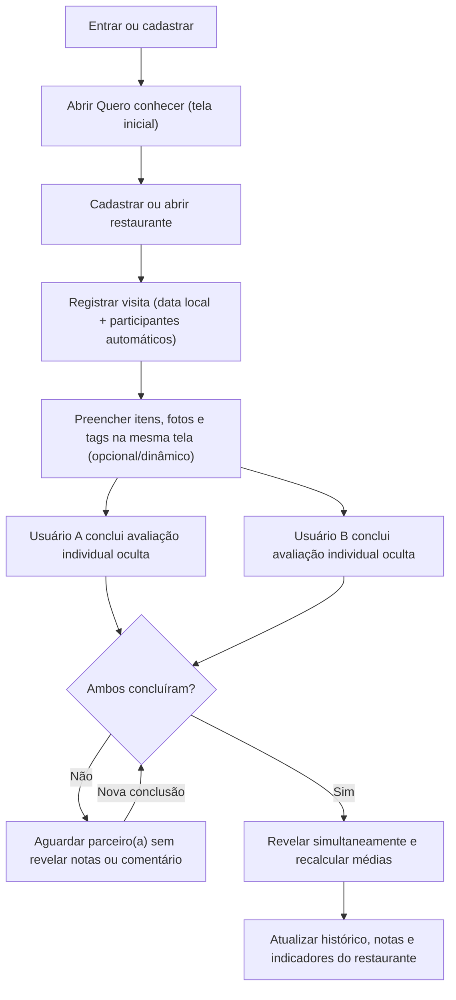
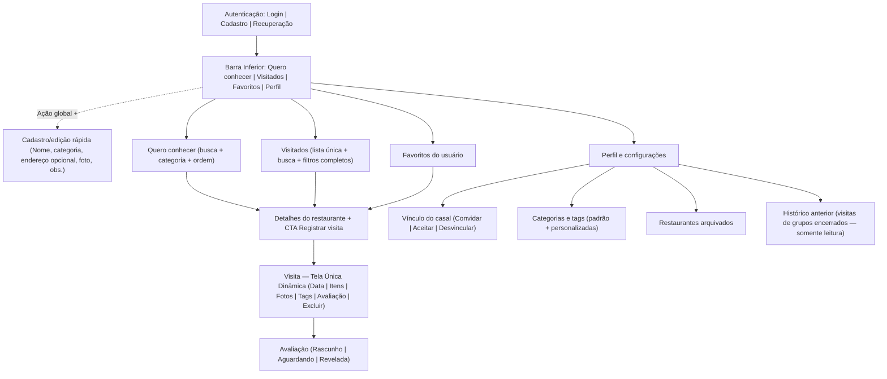
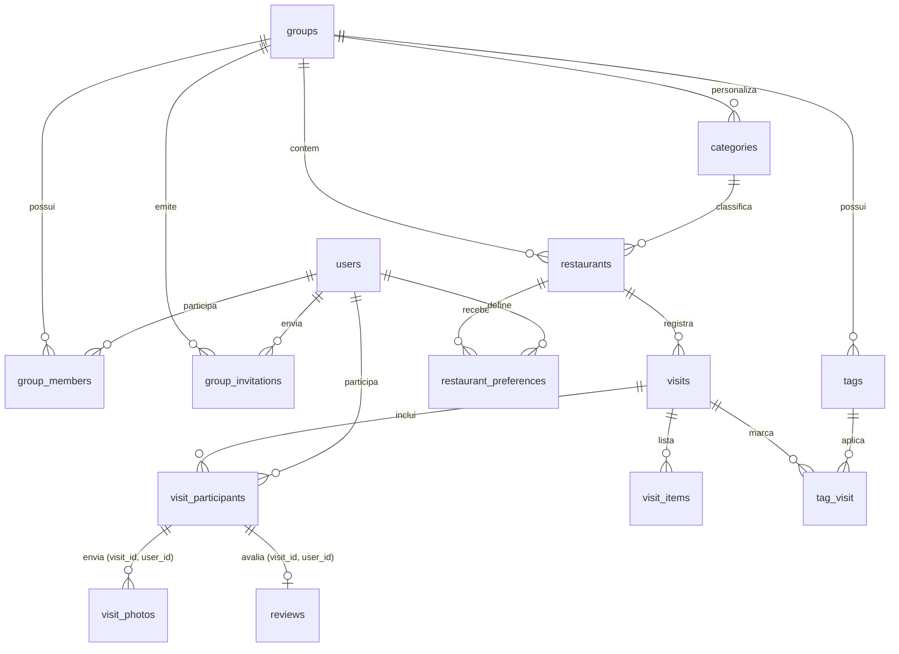
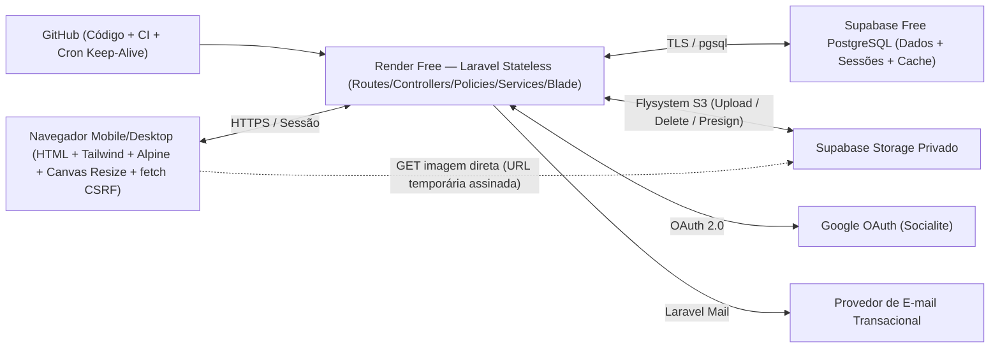

# ESPECIFICAÇÃO FUNCIONAL E TÉCNICA — Aplicativo Web de Reviews de Restaurantes

> **Diário gastronômico compartilhado** para registrar lugares, visitas, gastos e avaliações individuais do casal.

| Campo | Definição |
| :--- | :--- |
| **Identificador** | `EFT-RR-MVP-001` |
| **Versão** | `1.1` (Baseline revisada e consolidada) |
| **Data da revisão** | 19 de novembro de 2026 |
| **Produto** | Aplicativo Web de Reviews de Restaurantes |
| **Responsável pelo produto** | Luiz Fernando Brito Ferreira |
| **Público do documento** | Product Owner, desenvolvimento, QA e responsáveis pela implantação |
| **Status** | Aprovado para início da implementação do MVP |
| **Tecnologia-alvo** | Laravel 13, Blade, Tailwind CSS, Alpine.js, PostgreSQL e serviços gratuitos de infraestrutura |
| **Escopo** | Primeira versão funcional, privada, mobile first e destinada inicialmente a um casal |

---

## Histórico de Revisões

| Versão | Data | Descrição | Status |
| :--- | :--- | :--- | :--- |
| 1.0 | 26/08/2026 | Consolidação integral inicial dos requisitos, regras, modelo de dados, arquitetura e implantação. | Substituída |
| **1.1** | **19/11/2026** | **Revisão crítica e correções pré-implementação:** lock concorrente no trigger de limite de membros; integridade *cross-group* de categorias/tags; colunas `disk` em `users` e `restaurants`; criação automática de novo grupo individual e área *Perfil > Histórico anterior* após desvinculação; fluxo de exclusão de visita; `address` opcional; proteção contra *pre-account takeover* no login Google; busca por nome e matriz de filtros por aba; bloqueio de data futura e timezone explícito; interatividade da `TEL-06` via Alpine + `fetch()` (sessão/CSRF); compressão *client-side* de imagens + URLs assinadas; job periódico de keep-alive no Supabase Free; desambiguação da fórmula de média histórica e checklist Laravel 13 na Fase 0. | **Baseline Atual** |

> [!IMPORTANT]
> **Caráter da baseline:** Esta versão (`1.1`) substitui integralmente a versão `1.0` como fonte de verdade do MVP. Todas as decisões pendentes levantadas na auditoria da v1.0 foram fechadas e incorporadas nos requisitos, regras de negócio, telas, DDL, testes e ADRs.

---

## 1. Sumário Executivo

### 1.1 Contexto e problema
O produto nasce da necessidade de duas pessoas manterem, em um único lugar, os restaurantes que desejam conhecer e o histórico das experiências vividas em conjunto. O aplicativo substitui anotações dispersas, conversas e lembranças informais por um diário gastronômico estruturado, privado e rápido de usar no celular.

O foco não é competir com plataformas públicas como Google Maps, TripAdvisor ou redes sociais. A primeira versão é um produto íntimo e colaborativo: o casal cadastra os lugares manualmente, registra cada visita, inclui itens e valores quando desejar, guarda fotos e faz avaliações individuais que permanecem ocultas até que ambos concluam.

### 1.2 Visão do produto
> [!NOTE]
> **Visão:** Oferecer ao casal uma experiência mobile first para descobrir, organizar e recordar sua vida gastronômica, preservando opiniões individuais sem viés e produzindo uma visão consolidada das visitas e dos restaurantes.

### 1.3 Objetivos do MVP
* Permitir cadastro e autenticação por e-mail/senha e Google com proteção contra tomada de conta.
* Vincular duas contas por convite e aceite, formando o contexto compartilhado do casal.
* Manter uma lista de restaurantes que o casal deseja conhecer com cadastro rápido e sem atrito.
* Registrar múltiplas visitas ao mesmo restaurante sem perder o histórico, permitindo também corrigir ou excluir registros criados por engano.
* Registrar itens consumidos, quantidades, valores, fotos e tags de forma opcional e fluida na mesma tela.
* Permitir avaliações individuais e secretas até a conclusão simultânea de ambos.
* Calcular notas consolidadas, gastos e indicadores do restaurante a partir do histórico.
* Executar como aplicação web monolítica em Laravel, Blade e Alpine.js, sem API pública no MVP.
* Operar inicialmente em infraestrutura gratuita com mitigações concretas para memória, armazenamento e pausa por inatividade.

### 1.4 Critério de sucesso
O MVP será considerado funcional quando duas contas reais conseguirem completar todo o fluxo sem intervenção manual no banco de dados: entrar, formar o vínculo, cadastrar restaurante, registrar visita, incluir itens/fotos/tags, concluir avaliações individuais, revelar as avaliações, consultar médias e histórico, buscar/filtrar listas, excluir eventual visita incorreta, preservar os dados após novo deploy e manter a disponibilidade do banco sem pausa inesperada.


*Figura 1 — Fluxo principal de valor do produto.*

---

## 2. Escopo, Premissas e Limites

### 2.1 Escopo incluído no MVP

| Domínio | Entregas do MVP |
| :--- | :--- |
| **Contas** | Cadastro, login, logout, recuperação de senha, verificação de e-mail e login com Google com unificação segura. |
| **Vínculo** | Convite por e-mail, aceite/recusa, grupo compartilhado com no máximo dois membros ativos, desvinculação com criação automática de novo grupo individual e área *Perfil > Histórico anterior*. |
| **Restaurantes** | Cadastro manual rápido (endereço opcional), edição compartilhada, categoria principal, foto de capa, observação, status e arquivamento. |
| **Preferências** | Favorito e Não voltaria por usuário, mutuamente exclusivos. |
| **Visitas** | Múltiplas visitas por restaurante, data editável (sem data futura, fuso local), participantes automáticos, itens, fotos (com compressão *client-side*), tags, avaliações e exclusão com confirmação. |
| **Avaliações** | Quatro critérios inteiros de 0 a 10, comentário individual opcional, ocultação, revelação simultânea e recálculo. |
| **Listas e filtros** | Quero conhecer, Visitados, Favoritos, busca textual por nome, ordenação e filtros específicos por aba. |
| **Indicadores** | Notas consolidadas, quantidade de visitas, última visita, total gasto e ticket médio por pessoa. |
| **Operação** | Aplicação web responsiva, mobile first, monolítica (Blade + Alpine + `fetch()` web/CSRF), PostgreSQL, storage externo privado e keep-alive automatizado. |

### 2.2 Fora do escopo da primeira versão

| Tema | Direcionamento futuro |
| :--- | :--- |
| **Integrações de local** | Pesquisa automática em mapas, geocodificação, importação de dados e APIs de restaurantes. |
| **Uso individual em visitas** | Visitas sozinho, visitantes adicionais ou grupos com mais de duas pessoas. |
| **Recursos públicos** | Reviews públicas, feed, seguidores, comentários públicos e publicação de fotos. |
| **Câmera dedicada** | Ação explícita para abrir a câmera; o MVP trabalha com seleção de arquivos/galeria do dispositivo. |
| **Financeiro avançado** | Dashboard geral de gastos, divisão de conta, orçamento e análises temporais. |
| **Inteligência e recomendação** | Sugestões automáticas, ranking inteligente e sorteio de restaurante. |
| **Cardápio consolidado** | Unificação automática de itens repetidos e histórico de preços por produto. |
| **Gestão sofisticada pós-vínculo** | Ocultar visita histórica, excluir participação individual ou mesclar históricos de grupos. |
| **SPA / API pública** | React, Vue, aplicativo nativo, API REST pública, Sanctum, Passport ou JWT. |

### 2.3 Premissas e restrições
* O uso inicial será feito por duas pessoas conhecidas e vinculadas como casal.
* Os restaurantes serão cadastrados manualmente, sem restrição geográfica de cidade ou país.
* No MVP, toda visita exige os dois membros ativos do grupo como participantes.
* A interface será em português; nomes de classes, tabelas, colunas e código-fonte serão em inglês.
* O banco será PostgreSQL e a persistência será controlada exclusivamente por migrations Laravel.
* A aplicação permanece simples: MVC, Services para regras transacionais, Eloquent, Blade e Alpine.js; sem Repository Pattern prematuro.
* O fuso horário padrão da aplicação será `America/Sao_Paulo` (configurável via `APP_TIMEZONE`), garantindo que datas de negócio não sofram deslocamento por UTC.
* A infraestrutura gratuita não oferece SLA, possui *cold start* no Render Free e limite de 512 MB de RAM; por isso a compressão de imagens ocorre no cliente e há keep-alive periódico para o banco Supabase Free.
* Todas as fotos (perfil, capa e visita) são privadas por padrão e armazenam `disk` + `path`, nunca URL absoluta.

---

## 3. Atores, Stakeholders e Glossário

### 3.1 Stakeholders

| Stakeholder | Interesse | Responsabilidade |
| :--- | :--- | :--- |
| **Product Owner / cliente** | Produto útil e ágil para o uso cotidiano do casal. | Validar requisitos, priorizar mudanças e aceitar entregas. |
| **Usuário A** | Cadastrar lugares, visitas e avaliações próprias. | Manter seus dados corretos e concluir avaliações. |
| **Usuário B / parceiro(a)** | Compartilhar os mesmos restaurantes e visitas. | Aceitar vínculo, colaborar e avaliar de forma independente. |
| **Desenvolvimento** | Construir uma solução simples, sustentável e segura. | Implementar conforme esta baseline, testar e manter migrations. |
| **QA** | Garantir que os fluxos, integridade e segurança funcionem ponta a ponta. | Validar critérios de aceite, concorrência, isolamento entre grupos e responsividade. |

### 3.2 Atores do sistema

| Ator | Descrição | Permissões centrais |
| :--- | :--- | :--- |
| **Visitante** | Pessoa sem sessão autenticada. | Entrar, cadastrar conta, recuperar senha e iniciar login Google. |
| **Usuário autenticado** | Conta ativa pertencente a um grupo ativo (individual ou em casal). | Gerenciar perfil, usar recursos do grupo ativo e consultar seu histórico anterior. |
| **Membro ativo do grupo** | Usuário pertencente ao contexto compartilhado atual. | Criar/editar/excluir recursos do grupo conforme regras de negócio. |
| **Participante histórico** | Usuário que saiu de um grupo encerrado, mas participou de visita anterior. | Consultar em modo somente leitura as visitas em que participou, via *Perfil > Histórico anterior*. |

### 3.3 Glossário

| Termo | Definição |
| :--- | :--- |
| **Grupo** | Estrutura interna que representa o espaço compartilhado do casal (ou espaço individual enquanto sem vínculo). Possui 1 membro antes do aceite ou após desvinculação, e no máximo 2 membros ativos no MVP. |
| **Quero conhecer** | Status inicial de restaurante ainda sem visita registrada (`TO_VISIT`). |
| **Visitado** | Status adquirido automaticamente após a primeira visita (`VISITED`); retorna a `TO_VISIT` se todas as visitas do restaurante forem excluídas. |
| **Visita** | Ocorrência datada em um restaurante, com participantes, itens opcionais, fotos opcionais, tags opcionais e avaliações. |
| **Avaliação concluída** | Avaliação individual submetida pelo usuário; permanece oculta enquanto o parceiro não conclui. |
| **Avaliação revelada** | Estado derivado da visita quando todos os participantes obrigatórios concluíram. |
| **Ticket por pessoa** | Total financeiro da visita dividido pela quantidade de participantes registrados. |
| **Ticket médio** | Total das visitas com informação financeira dividido pelo total de participações consideradas nessas visitas. |
| **Arquivado** | Restaurante com histórico retirado das listas ativas sem apagar visitas e avaliações. |
| **Histórico anterior** | Área somente leitura dentro de *Perfil* onde o usuário consulta visitas de grupos encerrados das quais participou. |
| **Preferência** | Marcação individual `Favorito` ou `Não voltaria`. |

---

## 4. Requisitos Funcionais

### 4.1 Autenticação e perfil

| ID | Requisito | Especificação |
| :--- | :--- | :--- |
| `RF-AUT-001` | Cadastrar conta | Permitir cadastro com nome, e-mail e senha, aplicando validação, hash seguro de senha, confirmação de e-mail e criação automática do grupo individual ativo. |
| `RF-AUT-002` | Entrar com e-mail e senha | Autenticar por sessão/cookie, regenerar a sessão após login e redirecionar para *Quero conhecer*. |
| `RF-AUT-003` | Entrar com Google | Disponibilizar OAuth 2.0 via Laravel Socialite, associando a identidade Google a uma conta local e garantindo criação do grupo individual ativo no primeiro acesso. |
| `RF-AUT-004` | Unificar métodos de acesso com segurança | Permitir que a mesma conta utilize senha e Google somente quando o e-mail correspondente já estiver **verificado** (`email_verified_at IS NOT NULL`). Caso exista conta local prévia com o mesmo e-mail ainda **não verificada**, autenticar via Google deve **zerar a senha local não verificada** (`password = NULL`), invalidar tokens de recuperação pendentes e marcar `email_verified_at`, prevenindo *pre-account takeover*. |
| `RF-AUT-005` | Recuperar senha | Enviar fluxo de redefinição por e-mail para contas que possuem senha local. |
| `RF-AUT-006` | Encerrar sessão | Permitir logout seguro, invalidando a sessão corrente. |
| `RF-AUT-007` | Editar perfil | Permitir alterar nome, foto de perfil (armazenada com `disk` + `path` privados) e dados autorizados, sem expor informações do parceiro. |

### 4.2 Grupo, convite e vínculo

| ID | Requisito | Especificação |
| :--- | :--- | :--- |
| `RF-GRP-001` | Manter espaço compartilhado ativo | Todo usuário autenticado deve operar sempre dentro de exatamente um grupo ativo (com 1 membro enquanto solteiro/pendente ou 2 membros quando vinculado). |
| `RF-GRP-002` | Convidar parceiro(a) | Permitir informar o e-mail do parceiro e enviar convite com token seguro (hash armazenado) e prazo configurável. |
| `RF-GRP-003` | Aceitar ou recusar convite | O convidado autenticado deve aceitar ou recusar, respeitando e-mail, validade e capacidade do grupo. Se o convidado estiver em um grupo individual vazio (sem outro membro e sem dados conflitantes), encerrar seu grupo individual ao ingressar no grupo do convite, dentro da mesma transação. |
| `RF-GRP-004` | Limitar membros | Impedir que o grupo possua mais de dois membros ativos no MVP, inclusive sob requisições concorrentes. |
| `RF-GRP-005` | Compartilhar dados | Restaurantes, categorias personalizadas, tags e visitas do grupo ativo devem aparecer aos dois membros ativos. |
| `RF-GRP-006` | Permissões equivalentes | Ambos os membros ativos podem criar, editar e excluir dados compartilhados do grupo, independentemente de quem cadastrou. |
| `RF-GRP-007` | Exibir situação do vínculo | O perfil deve informar parceiro vinculado, convite pendente ou ausência de vínculo. |
| `RF-GRP-008` | Desvincular casal e restaurar operação | Permitir encerramento explícito do vínculo em transação: encerrar o grupo atual (`ENDED`) e as associações ativas (`ENDED` + `left_at`), **criar automaticamente um novo grupo individual ativo vazio para cada ex-membro** e disponibilizar as visitas em que cada um participou na área **Perfil > Histórico anterior** (somente leitura). |

### 4.3 Restaurantes e preferências

| ID | Requisito | Especificação |
| :--- | :--- | :--- |
| `RF-RES-001` | Cadastrar restaurante | Formulário rápido com **nome** (obrigatório), **categoria principal** (obrigatória), **endereço em texto (opcional)**, **foto de capa (opcional)** e **observação (opcional)**. |
| `RF-RES-002` | Definir status inicial | Todo restaurante novo deve iniciar em *Quero conhecer* (`TO_VISIT`). |
| `RF-RES-003` | Editar restaurante | Permitir atualização dos dados por qualquer membro ativo do grupo. |
| `RF-RES-004` | Consultar detalhes | Exibir dados cadastrais, status, CTA *Registrar visita*, preferências do usuário, indicadores e histórico cronológico. |
| `RF-RES-005` | Marcar favorito | Permitir que cada usuário marque ou desmarque um restaurante como *Favorito*. |
| `RF-RES-006` | Marcar Não voltaria | Permitir marcação individual *Não voltaria*. |
| `RF-RES-007` | Aplicar exclusividade | Ao ativar *Favorito*, remover *Não voltaria* do mesmo usuário e vice-versa. |
| `RF-RES-008` | Atualizar status por visitas | Ao criar a primeira visita, mudar automaticamente o status do restaurante para *Visitado* (`VISITED`). Caso todas as visitas do restaurante sejam excluídas, retornar automaticamente para *Quero conhecer* (`TO_VISIT`). |
| `RF-RES-009` | Excluir sem histórico | Permitir exclusão física somente quando o restaurante não possuir visitas. |
| `RF-RES-010` | Arquivar com histórico | Restaurantes com visita devem ser arquivados, permanecendo disponíveis em *Perfil > Arquivados*. |
| `RF-RES-011` | Restaurar arquivado | Permitir reativar restaurante arquivado sem alterar seu histórico. |
| `RF-RES-012` | Exibir indicadores | Mostrar notas consolidadas, número de visitas, última visita, total gasto e ticket médio por pessoa. |

### 4.4 Categorias e tags

| ID | Requisito | Especificação |
| :--- | :--- | :--- |
| `RF-CAT-001` | Disponibilizar categorias padrão | Fornecer categorias globais, somente leitura para os usuários. |
| `RF-CAT-002` | Criar categoria personalizada | Permitir categoria pertencente ao grupo ativo, reutilizável pelos dois membros. |
| `RF-CAT-003` | Selecionar uma categoria válida | Cada restaurante deve possuir exatamente uma categoria principal, que obrigatoriamente seja global (`DEFAULT`) ou personalizada pertencente ao **mesmo grupo** do restaurante. |
| `RF-CAT-004` | Evitar duplicidade | Nomes devem ser únicos sem diferenciar maiúsculas/minúsculas no respectivo escopo. |
| `RF-TAG-001` | Criar tags | Permitir criação de tags livres pertencentes ao grupo ativo. |
| `RF-TAG-002` | Reutilizar tags do próprio grupo | Tags existentes do mesmo grupo devem ser selecionáveis em novas visitas; rejeitar associação de tags de outros grupos. |
| `RF-TAG-003` | Associar múltiplas tags | Uma visita pode ter zero ou várias tags e uma tag pode aparecer em várias visitas do grupo. |

### 4.5 Visitas, itens e fotos

| ID | Requisito | Especificação |
| :--- | :--- | :--- |
| `RF-VIS-001` | Registrar múltiplas visitas | Um restaurante pode possuir zero ou muitas visitas, cada uma preservada separadamente. |
| `RF-VIS-002` | Criar visita pelo restaurante | O CTA *Registrar visita* deve permanecer destacado mesmo quando já existe histórico. |
| `RF-VIS-003` | Preencher data local sem futuro | Usar a data atual no fuso horário configurado da aplicação (`America/Sao_Paulo`) como padrão, permitir edição para datas passadas e **bloquear datas futuras**. |
| `RF-VIS-004` | Vincular participantes | Adicionar automaticamente os dois membros ativos do grupo como participantes. |
| `RF-VIS-005` | Usar tela única dinâmica | Apresentar data, itens, fotos, tags e avaliação em seções de uma única tela, com interações fluidas sem recarregamento completo via Alpine.js + `fetch()` (rotas web com sessão/CSRF). Itens, fotos e tags são totalmente opcionais para permitir registro rápido (< 30s). |
| `RF-VIS-006` | Adicionar item | Botão *Adicionar item* com nome, quantidade e valor unitário. |
| `RF-VIS-007` | Editar/remover item | Qualquer membro ativo pode corrigir ou remover itens da visita. |
| `RF-VIS-008` | Calcular valores | Exibir subtotal por item, total da visita e valor por pessoa automaticamente. |
| `RF-VIS-009` | Adicionar várias fotos otimizadas | Permitir múltiplos uploads por visita por seleção de arquivo/galeria, com redimensionamento e compressão automáticos no navegador (*client-side*) antes do envio. |
| `RF-VIS-010` | Registrar autoria da foto | Cada foto deve manter o usuário responsável pelo envio e metadados (`disk`, `path`, `mime_type`, `size_bytes`). |
| `RF-VIS-011` | Consultar visita | Exibir data, itens, valores, fotos (via URL temporária assinada), tags e estado das avaliações. |
| `RF-VIS-012` | Editar dados da visita | Permitir correção da data e dos conteúdos compartilhados por membros ativos do grupo. |
| `RF-VIS-013` | Excluir visita com confirmação | Permitir que qualquer membro ativo do grupo exclua uma visita a qualquer momento mediante confirmação explícita (avisando que itens, fotos e avaliações da visita serão removidos). Em transação, excluir os registros, remover as fotos físicas do storage externo após o commit e, caso não restem outras visitas no restaurante, retornar o status do restaurante para `TO_VISIT` (*Quero conhecer*). |

### 4.6 Avaliações secretas

| ID | Requisito | Especificação |
| :--- | :--- | :--- |
| `RF-AVA-001` | Criar avaliação individual | Cada participante deve possuir no máximo uma avaliação para a visita. |
| `RF-AVA-002` | Avaliar quatro critérios | Comida, Ambiente, Atendimento e Custo-benefício, com notas inteiras de 0 a 10. |
| `RF-AVA-003` | Registrar comentário | Disponibilizar um campo livre, individual, sem título e opcional. |
| `RF-AVA-004` | Salvar e concluir | Permitir salvar rascunho e executar ação explícita *Concluir avaliação*. |
| `RF-AVA-005` | Ocultar conteúdo | Notas e comentário de um usuário nunca podem ser enviados no HTML/JSON ao parceiro antes da revelação. |
| `RF-AVA-006` | Exibir apenas status | O parceiro pode ver que a avaliação foi concluída, sem acessar seu conteúdo. |
| `RF-AVA-007` | Permitir edição antes da revelação | Quem concluiu primeiro pode alterar sua avaliação enquanto o parceiro ainda não concluiu. |
| `RF-AVA-008` | Revelar simultaneamente | Quando ambos concluírem, liberar as duas avaliações no mesmo momento. |
| `RF-AVA-009` | Mostrar avaliações separadas | Após a revelação, apresentar *Minha avaliação* e *Avaliação do parceiro* com notas e comentários. |
| `RF-AVA-010` | Editar após revelação | Permitir edição por ação explícita; recalcular médias sem ocultar novamente. |
| `RF-AVA-011` | Aguardar indefinidamente | Se apenas um avaliar, a visita permanece *Aguardando parceiro*, sem finalização unilateral. |
| `RF-AVA-012` | Consolidar histórico | As visitas reveladas alimentam as médias históricas do restaurante. |

### 4.7 Navegação, listas, busca e filtros

| ID | Requisito | Especificação |
| :--- | :--- | :--- |
| `RF-NAV-001` | Abrir Quero conhecer | Após autenticação, a tela inicial deve ser a lista *Quero conhecer* do grupo ativo. |
| `RF-NAV-002` | Usar navegação inferior | Exibir *Quero conhecer*, *Visitados*, *Favoritos* e *Perfil* na barra inferior mobile. |
| `RF-NAV-003` | Exibir ação global `+` | Disponibilizar ação destacada para cadastro rápido de restaurante. |
| `RF-NAV-004` | Mostrar card enxuto | Na lista *Quero conhecer*, mostrar foto, nome e categoria; endereço e tags ficam fora do card inicial. |
| `RF-NAV-005` | Ordenar listas | Permitir ordenação adequada a cada aba (Mais recente / Mais antigo em *Quero conhecer*; Mais recente / Mais antigo / Melhor nota em *Visitados*). |
| `RF-NAV-006` | Listar todos os visitados | *Visitados* deve usar lista única do grupo ativo, sem separar por ranking, com filtros e busca. |
| `RF-NAV-007` | Buscar e filtrar por aba | Oferecer busca textual por nome (case-insensitive) em todas as listas e aplicar filtros específicos por contexto conforme matriz da Seção 7.3. |
| `RF-NAV-008` | Listar favoritos pessoais | A aba *Favoritos* deve considerar exclusivamente a preferência do usuário autenticado dentro do grupo ativo. |
| `RF-NAV-009` | Adaptar para desktop | Manter funcionalidade e legibilidade em telas maiores sem abandonar a prioridade mobile. |
| `RF-NAV-010` | Acessar histórico anterior | Exibir em *Perfil > Histórico anterior* as visitas somente leitura de grupos encerrados em que o usuário foi participante. |

---

## 5. Regras de Negócio, Estados e Cálculos

| ID | Regra |
| :--- | :--- |
| `RN-001` | Um usuário pode estar em apenas um grupo ativo por vez, e todo usuário autenticado possui sempre um grupo ativo. |
| `RN-002` | O grupo pode ter um membro ativo (estado individual ou convite pendente) e no máximo dois membros ativos no MVP. |
| `RN-003` | Os dois membros ativos possuem os mesmos direitos sobre dados compartilhados; autoria é mantida para auditoria, não para limitar edição ou exclusão. |
| `RN-004` | O restaurante pertence ao grupo, não exclusivamente ao usuário que o cadastrou. |
| `RN-005` | Cada restaurante possui exatamente uma categoria principal. |
| `RN-006` | Categoria padrão é global (`group_id IS NULL`); categoria personalizada pertence a um grupo específico (`group_id IS NOT NULL`). |
| `RN-007` | Tag pertence a um grupo e é reutilizável pelos dois membros daquele grupo. |
| `RN-008` | Nomes de categoria e tag são únicos sem diferenciação de caixa dentro do respectivo escopo. |
| `RN-009` | Restaurante novo inicia como `TO_VISIT` (*Quero conhecer*). |
| `RN-010` | A primeira visita altera o restaurante para `VISITED` (*Visitado*); se todas as visitas forem excluídas, o status retorna automaticamente para `TO_VISIT`. |
| `RN-011` | `Favorito` e `Não voltaria` são individuais e mutuamente exclusivos para o mesmo usuário/restaurante. |
| `RN-012` | No MVP, a criação de visita exige dois membros ativos no grupo e adiciona ambos automaticamente. |
| `RN-013` | Somente participante da visita pode possuir avaliação ou ser autor de foto vinculada à visita. |
| `RN-014` | Cada participante possui no máximo uma avaliação por visita. |
| `RN-015` | As quatro notas aceitam apenas inteiros de 0 a 10 e possuem peso igual. |
| `RN-016` | Nota 10 em Custo-benefício representa excelente relação entre preço e experiência; não significa preço alto. |
| `RN-017` | Avaliações individuais são ocultas até todos os participantes obrigatórios concluírem. |
| `RN-018` | Uma visita só contribui para médias conjuntas e históricas quando todas as avaliações obrigatórias estão concluídas. |
| `RN-019` | Editar uma avaliação já revelada não reativa o sigilo; apenas recalcula os indicadores. |
| `RN-020` | O comentário pertence ao usuário e permanece associado à avaliação individual. |
| `RN-021` | Fotos pertencem à visita e mantêm autor, `disk`, `path` e metadados técnicos. |
| `RN-022` | Subtotal, total, médias e indicadores são derivados; não devem ser persistidos como fonte primária no MVP. |
| `RN-023` | Visitas sem itens financeiros não reduzem artificialmente o ticket médio; exibem valor *Não informado*. |
| `RN-024` | Restaurante sem visita pode ser excluído fisicamente; com visita, somente arquivado (exceto se todas as visitas forem excluídas antes). |
| `RN-025` | Restaurantes arquivados não aparecem nas listas ativas por padrão. |
| `RN-026` | Ao desfazer o vínculo, cada ex-membro recebe automaticamente um novo grupo individual ativo e mantém acesso **somente leitura** em *Perfil > Histórico anterior* às visitas de grupos encerrados em que participou (incluindo nome/categoria do restaurante, itens, fotos, tags e avaliações reveladas). |
| `RN-027` | Lugares não visitados do grupo encerrado e divisão/migração do acervo pós-desvinculação permanecem fora do MVP. |
| `RN-028` | Notas digitadas são inteiras; médias podem ter casas decimais e são exibidas com uma casa decimal, mantendo precisão interna. |
| `RN-029` | E-mail deve ser normalizado (`trim` + `lowercase`) para comparação e unicidade sem diferenciar maiúsculas/minúsculas. |
| `RN-030` | Todos os arquivos de mídia (avatar, capa do restaurante e fotos da visita) são privados por padrão e armazenam explicitamente `disk` e `path`, nunca URL absoluta. |
| `RN-031` | Operações que afetam múltiplos registros devem ocorrer em transação (`DB::transaction`), utilizando bloqueios pessimistas (`FOR UPDATE`) onde houver risco de concorrência. |
| `RN-032` | Acesso a recursos é determinado por pertencimento ao grupo ativo ou participação histórica (`VisitParticipant`), nunca apenas pelo UUID informado na URL. |
| `RN-033` | **Integridade *cross-group*:** Um restaurante só pode referenciar categoria global (`DEFAULT`) ou personalizada (`CUSTOM`) do mesmo `group_id`. Uma visita só pode associar tags pertencentes ao mesmo `group_id` do restaurante da visita. |
| `RN-034` | **Exclusão de visita:** Qualquer membro ativo pode excluir uma visita mediante confirmação; a remoção de arquivos físicos no storage ocorre somente após confirmação do commit da transação no banco. |
| `RN-035` | **Data de visita e fuso horário:** `visit_date` não pode ser posterior à data corrente no fuso horário configurado da aplicação (`APP_TIMEZONE`, padrão `America/Sao_Paulo`). |

### 5.1 Fórmulas oficiais

| Indicador | Fórmula |
| :--- | :--- |
| **Subtotal do item** | $\text{quantidade} \times \text{valor\_unitário}$ |
| **Total da visita** | $\sum \text{subtotais dos itens da visita}$ |
| **Valor por pessoa** | $\text{total\_da\_visita} \div \text{número\_de\_participantes}$ |
| **Média individual** | $(\text{comida} + \text{ambiente} + \text{atendimento} + \text{custo\_benefício}) \div 4$ |
| **Média do critério na visita** | Média aritmética das notas do critério entre os participantes da visita, após revelação |
| **Média geral da visita** | Média aritmética das médias individuais reveladas na visita |
| **Média histórica do restaurante** | **Média aritmética das médias gerais de todas as visitas reveladas** do restaurante (cada visita tem peso igual, preservando consistência caso grupos futuros tenham quantidades variáveis de participantes; no MVP com sempre 2 participantes, coincide numericamente com a média de todas as avaliações individuais) |
| **Total gasto no restaurante** | $\sum \text{total das visitas com itens cadastrados}$ |
| **Ticket médio por pessoa** | $\left(\sum \text{total das visitas financeiras}\right) \div \left(\sum \text{participantes dessas visitas}\right)$ |

### 5.2 Estados derivados da avaliação

| Estado da visita | Condição e comportamento |
| :--- | :--- |
| **Pendente** | O usuário autenticado ainda não concluiu sua avaliação (rascunho ou não iniciada). |
| **Aguardando parceiro** | O usuário autenticado concluiu, mas o outro participante obrigatório ainda não concluiu; notas e comentário permanecem ocultos para o parceiro. |
| **Revelada** | Todos os participantes obrigatórios concluíram; avaliações separadas e médias ficam visíveis a todos os participantes. |

---

## 6. Casos de Uso e Fluxos Principais

### UC-01 — Cadastrar e entrar
* **Ator principal:** Visitante.
* **Fluxo principal:**
  1. Selecionar cadastro por e-mail/senha ou login Google.
  2. Informar/autorizar dados necessários e normalizar e-mail.
  3. Validar e criar/recuperar conta local. Se login Google encontrar conta local com e-mail **não verificado**, zerar `password`, invalidar tokens pendentes e marcar `email_verified_at`.
  4. Criar automaticamente um grupo individual ativo caso o usuário ainda não possua grupo ativo.
  5. Abrir a tela *Quero conhecer*.
* **Exceções:** E-mail já cadastrado e verificado via senha (orientar login ou unificação segura ao autenticar com Google); OAuth cancelado (retornar ao login sem criar conta incompleta).

### UC-02 — Vincular parceiro(a)
* **Ator principal:** Usuário autenticado.
* **Pré-condições:** Usuário pertence a grupo ativo com 1 membro e possui e-mail verificado.
* **Fluxo principal:**
  1. Abrir *Perfil > Parceiro* e informar e-mail do parceiro.
  2. Gerar convite com token aleatório (persistido como hash) e prazo configurável.
  3. Enviar e-mail de convite.
  4. Parceiro entra/cadastra conta e aceita o convite.
  5. Em transação com lock na linha do grupo (`SELECT ... FOR UPDATE`): verificar validade, confirmar que o grupo destino tem < 2 membros ativos, encerrar o grupo individual vazio do convidado (se houver) e inserir o convidado em `group_members` como `ACTIVE`.
  6. Exibir vínculo ativo aos dois.
* **Exceções:** Grupo já possui 2 membros (bloqueado via lock + trigger); convidado já pertence a outro grupo com 2 membros ou com dados ativos (bloquear e orientar desvinculação prévia).

### UC-03 — Cadastrar restaurante
* **Ator principal:** Membro ativo do grupo.
* **Fluxo principal:**
  1. Tocar no botão global `+`.
  2. Informar nome, categoria (global ou personalizada do grupo) e, opcionalmente, endereço, foto de capa (comprimida no cliente) e observação.
  3. Validar que a categoria é global ou pertence ao mesmo `group_id`.
  4. Criar restaurante como `TO_VISIT` e salvar foto de capa com `cover_photo_disk` + `cover_photo_path`.
  5. Redirecionar para detalhes ou lista.

### UC-04 — Registrar visita
* **Ator principal:** Membro ativo do grupo.
* **Pré-condições:** Restaurante ativo (não arquivado) e grupo com 2 membros ativos.
* **Fluxo principal:**
  1. Abrir o restaurante e tocar *Registrar visita*.
  2. Definir `visit_date` com a data atual no fuso `APP_TIMEZONE` (editável para passado; bloqueado para futuro).
  3. Em transação: criar visita, adicionar os dois participantes ativos em `visit_participants` e alterar o restaurante para `VISITED` caso estivesse em `TO_VISIT`.
  4. Abrir `TEL-06` (*Visita*) onde o usuário pode, de forma opcional e dinâmica (via Alpine + `fetch()` sem recarregar a página), adicionar itens, subir fotos comprimidas no cliente, marcar/criar tags do grupo ou ir direto para a avaliação individual.

### UC-05 — Concluir avaliações secretas
* **Ator principal:** Dois participantes da visita.
* **Fluxo principal:**
  1. Usuário A informa 4 notas (0–10) e comentário opcional e aciona *Concluir avaliação*.
  2. Parceiro vê somente o status *Concluída* — os valores numéricos e o texto nunca são serializados na resposta HTTP enquanto não revelada.
  3. Usuário B informa e conclui sua avaliação.
  4. Sistema deriva estado *Revelada* e libera ambas as avaliações simultaneamente, recalculando médias da visita e do restaurante.
* **Alternativas:** Edição antes da revelação atualiza sem revelar; edição após revelação recalcula sem reocultar.

### UC-06 — Buscar, consultar e filtrar restaurantes
* **Ator principal:** Usuário autenticado.
* **Fluxo principal:**
  1. Selecionar *Quero conhecer*, *Visitados* ou *Favoritos*.
  2. Utilizar busca textual por nome e/ou painel de filtros compatíveis com a aba ativa.
  3. Aplicar filtros e ordenação, preservando estado na navegação de retorno.
  4. Tratar indicadores ausentes como *Não informado* (nunca como zero).

### UC-07 — Arquivar e restaurar restaurante
* **Ator principal:** Membro ativo do grupo.
* **Fluxo principal:**
  1. Para restaurante com ao menos uma visita, selecionar *Arquivar* no menu do restaurante.
  2. Confirmar e gravar `archived_at`.
  3. Retirar das listas ativas mantendo histórico intacto e permitir restauração em *Perfil > Arquivados*.
  4. Para restaurante sem visitas, oferecer *Excluir* fisicamente.

### UC-08 — Desvincular casal
* **Ator principal:** Membro ativo do grupo.
* **Pré-condições:** Grupo ativo possui dois membros ativos.
* **Fluxo principal:**
  1. Abrir *Perfil > Parceiro* e selecionar *Desvincular*.
  2. Exibir confirmação explicando que o grupo compartilhado será encerrado, cada um receberá um novo espaço limpo e as visitas realizadas permanecerão acessíveis em *Perfil > Histórico anterior* (somente leitura).
  3. Em transação:
     * Atualizar `groups.status = 'ENDED'` no grupo atual.
     * Atualizar `group_members.status = 'ENDED'` e `left_at = NOW()` para ambos os membros.
     * Cancelar/expirar convites pendentes do grupo.
     * Criar automaticamente um novo grupo (`status = 'ACTIVE'`) + registro em `group_members` (`status = 'ACTIVE'`) para cada um dos dois ex-membros.
  4. Redirecionar o usuário para seu novo espaço ativo, bloqueando qualquer nova escrita nos recursos do grupo encerrado.

### UC-09 — Excluir visita
* **Ator principal:** Membro ativo do grupo.
* **Pré-condições:** Visita pertence a restaurante do grupo ativo do usuário.
* **Fluxo principal:**
  1. Na tela de detalhes da visita (`TEL-06`), abrir menu de ações e selecionar *Excluir visita*.
  2. Exibir confirmação explícita informando que itens, fotos e avaliações daquela visita serão removidos permanentemente (e, se for a última visita, o restaurante voltará para *Quero conhecer*).
  3. Coletar referências (`disk`, `path`) das fotos vinculadas em `visit_photos`.
  4. Em transação: excluir a visita (`CASCADE` remove `visit_participants`, `visit_items`, `visit_photos`, `tag_visit` e `reviews`), contar visitas restantes do restaurante e, se zero, atualizar `restaurants.status = 'TO_VISIT'`.
  5. Após o commit bem-sucedido (`DB::afterCommit`), remover os arquivos físicos no storage externo (registrando log estruturado caso algum arquivo falhe na exclusão remota sem quebrar a operação do usuário).
  6. Redirecionar para a tela de detalhes do restaurante com indicadores recalculados.

---

## 7. Arquitetura de Informação e Especificação de Telas

### 7.1 Princípios de experiência
* **Mobile first:** Projetar primeiro para largura de `360px` a `430px` e adaptar progressivamente para desktop.
* **Registro rápido (< 30 segundos):** Endereço do restaurante é opcional; na visita, itens, fotos e tags são opcionais e editáveis depois, evitando fadiga de preenchimento na saída do restaurante.
* **Interação fluida sem SPA:** Na tela de visita (`TEL-06`), adicionar/editar/remover itens, alternar tags e subir fotos ocorre via Alpine.js + `fetch()` sem recarregar a página inteira.
* **Ação principal evidente:** *Registrar visita* permanece destacado na página do restaurante.
* **Privacidade explícita:** Deixar claro visualmente que a avaliação ficará oculta até o parceiro concluir.
* **Acessibilidade:** Área de toque mínima de `44 × 44 px`, contraste adequado, rótulos semânticos e feedback que não depende apenas de cor.


*Figura 2 — Mapa de navegação e telas do MVP (v1.1).*

### 7.2 Inventário de telas

| ID | Tela | Conteúdo / objetivo |
| :--- | :--- | :--- |
| `TEL-01` | Login | Entrar por e-mail/senha ou Google; acesso a cadastro e recuperação. |
| `TEL-02` | Cadastro | Nome, e-mail, senha e confirmação. |
| `TEL-03` | Quero conhecer | Home do grupo ativo; cards enxutos (foto, nome, categoria), busca por nome, filtro de categoria e ordenação. |
| `TEL-04` | Cadastrar/editar restaurante | Formulário rápido mobile; nome e categoria obrigatórios; endereço, foto de capa (comprimida no cliente) e observação opcionais. |
| `TEL-05` | Detalhes do restaurante | Dados, preferências individuais, indicadores, histórico cronológico e CTA *Registrar visita*. |
| `TEL-06` | Visita | Tela única dinâmica (Alpine + `fetch()`): data local, itens/totais, galeria/upload de fotos, tags, bloco de avaliação e ação *Excluir visita* com confirmação. |
| `TEL-07` | Avaliação | Bloco/modal com 4 controles `0–10`, comentário opcional e ação *Concluir*; estados Pendente/Aguardando/Revelada. |
| `TEL-08` | Visitados | Lista única do grupo ativo com nota consolidada, contagem de visitas, busca por nome e filtros completos. |
| `TEL-09` | Favoritos | Lista filtrada pela preferência `favorite` do usuário atual dentro do grupo ativo. |
| `TEL-10` | Perfil | Dados pessoais, avatar, vínculo, categorias/tags, arquivados, **Histórico anterior** e logout. |
| `TEL-11` | Parceiro e convites | Enviar convite, acompanhar pendência, aceitar/recusar e desvincular. |
| `TEL-12` | Categorias e tags | Criar e manter taxonomias personalizadas do grupo ativo. |
| `TEL-13` | Arquivados | Listar e restaurar restaurantes arquivados do grupo ativo. |
| `TEL-14` | Recuperação de senha | Solicitação e redefinição por token de e-mail. |
| `TEL-15` | Histórico anterior | Lista e detalhe **somente leitura** das visitas de grupos encerrados das quais o usuário participou. |

### 7.3 Matriz de busca, filtros e ordenação por aba

| Aba / Tela | Busca textual | Filtros aplicáveis | Ordenação |
| :--- | :--- | :--- | :--- |
| **Quero conhecer (`TEL-03`)** | Nome do restaurante | Categoria | Mais recente / Mais antigo |
| **Visitados (`TEL-08`)** | Nome do restaurante | Categoria, Nota mínima, Tags, Faixa de ticket médio, Preferência (*Favorito* / *Não voltaria*) | Mais recente (última visita) / Mais antigo / Melhor nota |
| **Favoritos (`TEL-09`)** | Nome do restaurante | Categoria, Status (*Quero conhecer* / *Visitado*) | Mais recente / Melhor nota |
| **Histórico anterior (`TEL-15`)** | Nome do restaurante | Categoria | Data da visita (mais recente primeiro) |

---

## 8. Modelo de Domínio e DER Lógico

### 8.1 Entidades do domínio

| Entidade | Responsabilidade |
| :--- | :--- |
| `User` | Conta individual, identidade, autenticação local/Google, avatar (`disk` + `path`) e relações pessoais. |
| `Group` | Contexto compartilhado do casal ou espaço individual ativo (`ACTIVE` / `ENDED`). |
| `GroupMember` | Vínculo histórico entre usuário e grupo, com entrada, saída e status. |
| `GroupInvitation` | Convite de associação enviado por e-mail com token em hash e expiração. |
| `Category` | Categoria global padrão (`DEFAULT`) ou personalizada do grupo (`CUSTOM`). |
| `Restaurant` | Estabelecimento cadastrado no grupo, com endereço opcional e foto de capa (`disk` + `path`). |
| `RestaurantPreference` | `Favorito` / `Não voltaria` de um usuário para um restaurante. |
| `Visit` | Ocorrência datada (sem data futura) em um restaurante. |
| `VisitParticipant` | Participação do usuário na visita, base de autorização histórica em *Histórico anterior*. |
| `VisitItem` | Item consumido, quantidade e valor unitário. |
| `VisitPhoto` | Arquivo privado da visita com autoria, `disk`, `path` e metadados. |
| `Tag` | Marcador reutilizável pertencente ao grupo. |
| `Review` | Avaliação individual do participante para uma visita. |

### 8.2 Diagrama Entidade-Relacionamento


*Figura 3 — DER lógico consolidado do MVP (v1.1).*

---

## 9. Modelo Físico PostgreSQL

### 9.1 Convenções
* Tabelas e colunas em inglês e `snake_case`; tabelas no plural seguindo convenções Laravel.
* Chaves primárias `UUID`, geradas por `HasUuids` no Laravel ou `gen_random_uuid()` no DDL.
* Datas de negócio em `DATE` (calculadas na aplicação em `APP_TIMEZONE`); auditoria em `TIMESTAMPTZ`; valores monetários em `NUMERIC(12,2)`.
* Status em `VARCHAR` controlados por PHP Enums e reforçados por `CHECK` constraints.
* **Portabilidade de mídia (`RN-030`):** Todas as entidades com arquivos (`users`, `restaurants`, `visit_photos`) armazenam par explícito `*_disk` e `*_path` (nunca URL absoluta).

### 9.2 Dicionário resumido das tabelas

| Tabela | Finalidade | Campos principais |
| :--- | :--- | :--- |
| `users` | Conta e credenciais locais/Google. | `id`; `name`; `email`; `password?`; `google_id?`; `avatar_disk?`; `avatar_path?`; `email_verified_at?`; `remember_token`; timestamps |
| `groups` | Espaço compartilhado/individual. | `id`; `name?`; `status`; timestamps |
| `group_members` | Associação histórica usuário-grupo. | `id`; `group_id`; `user_id`; `status`; `joined_at`; `left_at?`; timestamps |
| `group_invitations` | Convites por e-mail. | `id`; `group_id`; `invited_by_user_id?`; `invited_email`; `token_hash`; `status`; `expires_at`; `responded_at?`; timestamps |
| `categories` | Categorias padrão/custom. | `id`; `group_id?`; `created_by_user_id?`; `name`; `type`; timestamps |
| `restaurants` | Dados do restaurante. | `id`; `group_id`; `category_id`; `created_by_user_id?`; `name`; `address?`; `notes?`; `cover_photo_disk?`; `cover_photo_path?`; `status`; `archived_at?`; timestamps |
| `restaurant_preferences` | Preferências individuais. | `id`; `restaurant_id`; `user_id`; `favorite`; `would_not_return`; timestamps |
| `visits` | Ocorrências de visita. | `id`; `restaurant_id`; `created_by_user_id?`; `visit_date`; timestamps |
| `visit_participants` | Participantes e autorização histórica. | `id`; `visit_id`; `user_id`; `added_at`; timestamps |
| `visit_items` | Itens e valores. | `id`; `visit_id`; `created_by_user_id?`; `name`; `quantity`; `unit_price`; timestamps |
| `visit_photos` | Fotos e autoria. | `id`; `visit_id`; `uploaded_by_user_id`; `disk`; `path`; `mime_type?`; `size_bytes?`; timestamps |
| `tags` | Tags do grupo. | `id`; `group_id`; `created_by_user_id?`; `name`; timestamps |
| `tag_visit` | Relação N:N visita-tag. | `visit_id`; `tag_id` |
| `reviews` | Avaliações individuais. | `id`; `visit_id`; `user_id`; `food?`; `environment?`; `service?`; `value_for_money?`; `comment?`; `status`; `completed_at?`; timestamps |

### 9.3 Chaves, restrições e blindagem de concorrência

| Tabela | Restrição |
| :--- | :--- |
| `users` | `UNIQUE LOWER(email)`; `UNIQUE google_id` parcial; `password` ou `google_id` obrigatório; `avatar_disk` e `avatar_path` ambos nulos ou ambos preenchidos. |
| `group_members` | `UNIQUE(group_id, user_id)`; índice único parcial garantindo 1 grupo ativo por usuário; trigger com **`SELECT ... FROM groups WHERE id = NEW.group_id FOR UPDATE`** antes da contagem para serializar aceites concorrentes e garantir no máximo 2 membros ativos. |
| `categories` | Padrão exige `group_id IS NULL`; personalizada exige `group_id IS NOT NULL`; unicidade case-insensitive por escopo. |
| `restaurants` | `address` opcional (`NULL`); `cover_photo_disk` e `cover_photo_path` ambos nulos ou ambos preenchidos. |
| `restaurant_preferences` | `UNIQUE(restaurant_id, user_id)`; `CHECK NOT(favorite AND would_not_return)`. |
| `visit_participants` | `UNIQUE(visit_id, user_id)`. |
| `visit_items` | `quantity > 0`; `unit_price >= 0`. |
| `visit_photos` | FK composta `(visit_id, uploaded_by_user_id)` para `visit_participants`. |
| `tags` | `UNIQUE(group_id, LOWER(name))`. |
| `tag_visit` | PK composta `(visit_id, tag_id)`. |
| `reviews` | `UNIQUE(visit_id, user_id)`; FK composta para `visit_participants`; notas `0..10`; conclusão exige todas as notas e `completed_at`. |

---

## 10. Arquitetura da Aplicação Laravel

### 10.1 Stack aprovada

| Camada | Tecnologia | Diretriz |
| :--- | :--- | :--- |
| **Framework** | Laravel 13 (`^13.0`) | Monólito web, MVC, sessão e ecossistema oficial (validar compatibilidade de pacotes na Fase 0). |
| **Linguagem** | PHP 8.3+ | Requisito mínimo do Laravel 13. |
| **Frontend** | Blade + Tailwind CSS + Alpine.js + Vite | Renderização server-side; interações dinâmicas da tela de visita (`TEL-06`) via **Alpine.js + `fetch()`** nas rotas web com sessão/CSRF (sem API pública nem SPA). |
| **Banco** | PostgreSQL | Supabase Free com workflow periódica de keep-alive no GitHub Actions. |
| **ORM** | Eloquent | Models, relações, query scopes e eager loading. |
| **Autenticação** | Laravel Fortify / custom Blade + Socialite | E-mail/senha e Google por sessão, com proteção contra *pre-account takeover*. |
| **Arquivos** | Flysystem S3 (Supabase Storage privado) | Compressão *client-side* (`<canvas>`) antes do upload; exibição exclusiva via **URLs temporárias assinadas**. |
| **Sessão / cache** | Database | Persistência fora do filesystem efêmero do Render, sem Redis no MVP. |
| **Fila** | `sync` inicial; `database` preparada | Baixo volume no free tier. |
| **Testes** | Pest ou PHPUnit | Unitários, feature, concorrência, isolamento *cross-group* e integração PostgreSQL. |
| **Deploy** | GitHub → Render Free | Build e deploy automáticos de container stateless. |


*Figura 4 — Arquitetura lógica, fluxo de mídia assinada e implantação inicial (v1.1).*

### 10.2 Padrão de interatividade da Tela de Visita (`TEL-06`)
Para manter a simplicidade do monólito sem sacrificar a fluidez no celular:
* Todas as ações dinâmicas da visita (adicionar/editar/remover item, alternar/criar tag, enviar/remover foto, salvar/concluir avaliação) utilizam **rotas web autenticadas por sessão (`web`, `auth`, `verified`)** com cabeçalho `X-CSRF-TOKEN` e `Accept: application/json` (ou resposta de fragmento HTML Blade).
* Não há tokens Bearer, Sanctum, Passport ou contratos de API pública.
* Caso o JavaScript falhe ou demore a carregar, os formulários principais mantêm degradabilidade graciosa (*progressive enhancement*).

### 10.3 Controllers e Services atualizados

| Componente | Responsabilidades atualizadas na v1.1 |
| :--- | :--- |
| `VisitController` | `store`, `show`, `edit`, `update` e **`destroy`** (exclusão de visita com confirmação). |
| `PastHistoryController` | `index` e `show` para *Perfil > Histórico anterior* (`TEL-15`), listando visitas de grupos encerrados em modo somente leitura via `VisitParticipant`. |
| `Auth/GoogleAuthController` | Fluxo OAuth Socialite com proteção *pre-account takeover* (`RF-AUT-004`) e garantia de criação do grupo individual inicial. |
| `GroupService` | Criar grupo individual inicial; convidar; aceitar convite com lock `FOR UPDATE` e encerramento de grupo individual vazio; **desvincular encerrando grupo antigo e criando novo grupo individual ativo para cada ex-membro**. |
| `VisitService` | Criar visita com data validada no fuso `APP_TIMEZONE`; validar tags pertencentes ao `group_id`; **excluir visita em transação, recalcular status do restaurante (`TO_VISIT` se 0 visitas) e remover arquivos do storage via `DB::afterCommit`**. |
| `ReviewService` | Salvar/concluir, determinar revelação, **filtrar completamente campos de nota/comentário do parceiro antes da revelação (nunca enviar à view/JSON)** e calcular médias derivadas. |
| `StorageService` | Validar MIME/tamanho pós-compressão *client-side*, salvar com nome aleatório (`disk` + `path`), gerar **URLs temporárias assinadas** (TTL padrão 15 min) e remover arquivos com tratamento seguro pós-commit. |

### 10.4 Policies e validações *cross-group*
* `RestaurantPolicy`: garante pertencimento ao grupo ativo para escrita; permite leitura restrita de dados básicos do restaurante quando acessado via visita em *Histórico anterior*.
* `VisitPolicy`: `view` aceita membro do grupo ativo **ou** `VisitParticipant` de grupo encerrado; `update`, `delete`, `addItem`, `addPhoto` e `review` exigem grupo **ativo** (bloqueando qualquer alteração em grupos encerrados).
* `StoreRestaurantRequest` / `UpdateRestaurantRequest`: regra customizada garantindo que `category_id` seja `DEFAULT` ou `CUSTOM` com `categories.group_id === $activeGroup->id`.
* `AttachVisitTagRequest` / `VisitService`: regra garantindo que todas as `tag_id` pertençam ao `group_id` do restaurante da visita.

### 10.5 Rotas web de referência

```php
Route::middleware(['auth', 'verified'])->group(function () {
    Route::get('/', [RestaurantController::class, 'toVisit'])->name('home');
    Route::get('/visited', [RestaurantController::class, 'visited'])->name('restaurants.visited');
    Route::get('/favorites', [RestaurantController::class, 'favorites'])->name('restaurants.favorites');

    Route::resource('restaurants', RestaurantController::class);
    Route::post('restaurants/{restaurant}/archive', [RestaurantArchiveController::class, 'archive'])->name('restaurants.archive');
    Route::post('restaurants/{restaurant}/restore', [RestaurantArchiveController::class, 'restore'])->name('restaurants.restore');
    Route::put('restaurants/{restaurant}/preference', [RestaurantPreferenceController::class, 'update'])->name('restaurants.preference.update');

    Route::post('restaurants/{restaurant}/visits', [VisitController::class, 'store'])->name('restaurants.visits.store');
    Route::get('visits/{visit}', [VisitController::class, 'show'])->name('visits.show');
    Route::patch('visits/{visit}', [VisitController::class, 'update'])->name('visits.update');
    Route::delete('visits/{visit}', [VisitController::class, 'destroy'])->name('visits.destroy');

    // Rotas web (sessão + CSRF) consumidas via Alpine + fetch() na TEL-06
    Route::post('visits/{visit}/items', [VisitItemController::class, 'store'])->name('visits.items.store');
    Route::patch('visits/{visit}/items/{item}', [VisitItemController::class, 'update'])->name('visits.items.update');
    Route::delete('visits/{visit}/items/{item}', [VisitItemController::class, 'destroy'])->name('visits.items.destroy');
    Route::post('visits/{visit}/photos', [VisitPhotoController::class, 'store'])->name('visits.photos.store');
    Route::delete('visits/{visit}/photos/{photo}', [VisitPhotoController::class, 'destroy'])->name('visits.photos.destroy');
    Route::put('visits/{visit}/tags', [VisitTagController::class, 'sync'])->name('visits.tags.sync');
    Route::put('visits/{visit}/review', [ReviewController::class, 'save'])->name('visits.review.save');
    Route::post('visits/{visit}/review/complete', [ReviewController::class, 'complete'])->name('visits.review.complete');

    // Perfil, parceiro, taxonomias, arquivados e histórico anterior
    Route::get('profile/history', [PastHistoryController::class, 'index'])->name('profile.history.index');
    Route::get('profile/history/{visit}', [PastHistoryController::class, 'show'])->name('profile.history.show');
});
```

---

## 11. Segurança, Privacidade e Requisitos Não Funcionais

### 11.1 Segurança e privacidade

| ID | Requisito |
| :--- | :--- |
| `RNF-SEG-001` | Autenticação por sessão com cookie `HttpOnly`, `Secure` em produção, `SameSite=Lax` e proteção CSRF. |
| `RNF-SEG-002` | Senhas com hash seguro padrão do Laravel; nunca armazenar texto puro ou tokens OAuth desnecessários. |
| `RNF-SEG-003` | Policies em todos os recursos com UUID; impedir IDOR, acesso cruzado entre grupos e associação *cross-group* de categorias/tags. |
| `RNF-SEG-004` | Convites com token aleatório armazenado como hash, expiração e uso único. |
| `RNF-SEG-005` | Bucket de fotos privado; exibição feita exclusivamente por **URLs temporárias assinadas (TTL curto, ex: 15 min)** geradas sob demanda após autorização via Policy. |
| `RNF-SEG-006` | Validar MIME real (`image/jpeg`, `image/png`, `image/webp`), extensão, tamanho máximo (ex: 5 MB pós-compressão cliente) e gerar nome aleatório. |
| `RNF-SEG-007` | Normalizar entradas, escapar saída Blade e bloquear HTML livre em comentários. |
| `RNF-SEG-008` | Segredos exclusivamente em variáveis de ambiente; nunca versionar `.env`. |
| `RNF-SEG-009` | Logs não devem registrar senha, tokens, URLs assinadas ou conteúdo sensível de avaliações. |
| `RNF-SEG-010` | Acesso histórico após desvinculação deve ser estritamente somente leitura via `VisitParticipant`. |
| `RNF-SEG-011` | **Proteção contra *pre-account takeover*:** Login Google só preserva senha local existente se `email_verified_at` já estiver preenchido; caso contrário, invalida a senha local não verificada e tokens de reset antes de vincular `google_id`. |

### 11.2 Desempenho, confiabilidade e recursos no Free Tier

| ID | Requisito |
| :--- | :--- |
| `RNF-PER-001` | Paginar listas (valor inicial recomendado de 20 itens). |
| `RNF-PER-002` | Usar eager loading e agregações SQL para evitar consultas N+1. |
| `RNF-PER-003` | **Compressão *client-side* obrigatória de imagens:** Redimensionar fotos no navegador via `<canvas>` (lado maior máximo `1600px`, formato WebP/JPEG qualidade ~`0.8`, alvo `< 500 KB`) antes do upload, evitando consumo excessivo de RAM (`GD`/`Imagick`) nos 512 MB do Render Free e reduzindo uso de 4G e cota de Storage. |
| `RNF-PER-004` | Persistir sessão e cache no banco, nunca no filesystem efêmero do Render. |
| `RNF-PER-005` | Operações críticas protegidas por `DB::transaction` e lock `FOR UPDATE` em cenários de concorrência. |
| `RNF-PER-006` | Tratar indisponibilidade temporária do banco/storage com mensagem clara e sem perda silenciosa. |
| `RNF-PER-007` | Logs estruturados com contexto de usuário, request e operação, sem dados secretos. |
| `RNF-PER-008` | Configurar `APP_TIMEZONE=America/Sao_Paulo` para consistência de datas de visita e exibição temporal. |

---

## 12. Infraestrutura, Ambientes e Implantação

### 12.1 Topologia aprovada

| Componente | Serviço | Diretriz |
| :--- | :--- | :--- |
| **Código e automação** | GitHub + GitHub Actions | Repositório com CI, deploy trigger e **cron job de keep-alive**. |
| **Aplicação** | Render Free Web Service | Container stateless (512 MB RAM); aceita *cold start* por inatividade. |
| **Banco** | Supabase Free PostgreSQL | Banco remoto persistente mantido ativo pelo job de keep-alive. |
| **Fotos** | Supabase Storage Free | Bucket privado compatível com S3; acesso direto do navegador via URL assinada. |
| **OAuth** | Google Cloud Console | Client ID/secret e redirect URIs por ambiente. |
| **E-mail** | Provedor transacional via Laravel Mail | Escolha final antes do deploy (ex: Resend, Brevo ou Postmark free tier). |

### 12.2 Mitigação da pausa de 7 dias do Supabase Free (Keep-Alive)
Para evitar que o projeto Supabase Free seja pausado caso o casal fique mais de uma semana sem registrar visitas:
* Criar um workflow agendado no GitHub Actions (`.github/workflows/supabase-keepalive.yml`) executando **a cada 3 dias** (`0 12 */3 * *`).
* O workflow realiza uma consulta mínima (`SELECT 1;`) diretamente via `psql` usando secret `SUPABASE_KEEPALIVE_DB_URL` (ou aciona um endpoint `/health/db` autenticado por header secreto `X-Health-Token`).
* Em caso de falha no workflow, o GitHub envia alerta por e-mail ao mantenedor.

### 12.3 Variáveis de ambiente mínimas

```env
APP_NAME="Restaurant Reviews"
APP_ENV=production
APP_DEBUG=false
APP_TIMEZONE=America/Sao_Paulo
APP_URL=https://<servico>.onrender.com
APP_KEY=<secret>

DB_CONNECTION=pgsql
DB_HOST=<supabase-host-ou-pooler>
DB_PORT=5432
DB_DATABASE=postgres
DB_USERNAME=<secret>
DB_PASSWORD=<secret>
DB_SSLMODE=require

SESSION_DRIVER=database
CACHE_STORE=database
QUEUE_CONNECTION=sync

FILESYSTEM_DISK=photos
AWS_ACCESS_KEY_ID=<supabase-s3-key>
AWS_SECRET_ACCESS_KEY=<supabase-s3-secret>
AWS_DEFAULT_REGION=<region>
AWS_BUCKET=<private-bucket>
AWS_ENDPOINT=<supabase-s3-endpoint>
AWS_USE_PATH_STYLE_ENDPOINT=true

GOOGLE_CLIENT_ID=<secret>
GOOGLE_CLIENT_SECRET=<secret>
GOOGLE_REDIRECT_URI=<callback>

MAIL_MAILER=<provider>
MAIL_FROM_ADDRESS=<verified-sender>

HEALTH_CHECK_TOKEN=<secret-opcional>
```

### 12.4 Backup e recuperação
* `pg_dump` manual antes de migrations estruturais relevantes e rotina mensal de backup externo enquanto estiver no free tier.
* Exportação periódica das fotos do bucket para armazenamento secundário.
* Validar ao menos uma restauração completa em ambiente local/homologação antes do uso contínuo.

---

## 13. Estratégia de Testes e Critérios de Aceite

### 13.1 Cenários críticos obrigatórios

| ID | Cenário |
| :--- | :--- |
| `CT-001` | Usuário A convida B; B aceita (encerrando seu grupo individual vazio); grupo fica com 2 membros e dados são compartilhados. |
| `CT-002` | Terceiro membro é bloqueado mesmo em requisições concorrentes simultâneas (lock `FOR UPDATE` + trigger). |
| `CT-003` | Usuário não acessa restaurante ou visita de outro grupo alterando UUID. |
| `CT-004` | Primeira visita altera restaurante para `VISITED`, adiciona 2 participantes, usa data local (`APP_TIMEZONE`) e bloqueia data futura. |
| `CT-005` | Subtotal, total e ticket por pessoa são calculados corretamente com valores decimais. |
| `CT-006` | Avaliação A concluída permanece invisível para B (ausente inclusive no payload/HTML retornado a B). |
| `CT-007` | Após B concluir, ambas são reveladas simultaneamente e as médias da visita e histórica do restaurante são calculadas. |
| `CT-008` | Editar após revelação recalcula sem reocultar. |
| `CT-009` | Favorito e Não voltaria são mutuamente exclusivos por usuário, sem afetar o parceiro. |
| `CT-010` | Restaurante com visita não pode ser excluído fisicamente; é arquivado e restaurado. |
| `CT-011` | Fotos (comprimidas no cliente) persistem após redeploy e são exibidas via URL temporária assinada somente para usuários autorizados. |
| `CT-012` | Após desvinculação (`UC-08`), ambos recebem novo grupo individual ativo vazio, consultam suas visitas anteriores em *Perfil > Histórico anterior* em modo somente leitura e são impedidos de editar o grupo encerrado. |
| `CT-013` | Busca por nome e filtros combinados por aba retornam somente dados do grupo ativo e respeitam *Não informado*. |
| `CT-014` | Interface principal e `TEL-06` funcionam sem rolagem horizontal em `360px`, com atualização dinâmica de itens/tags/fotos via `fetch()` + CSRF. |
| `CT-015` | **Isolamento *cross-group*:** Tentativa de cadastrar restaurante com categoria `CUSTOM` de outro grupo ou anexar `tag` de outro grupo a uma visita é rejeitada com erro de validação/autorização. |
| `CT-016` | **Exclusão de visita:** Excluir visita remove itens/avaliações/fotos (banco + storage pós-commit); quando era a única visita do restaurante, o status retorna automaticamente para `TO_VISIT`. |
| `CT-017` | **Segurança OAuth (*pre-account takeover*):** Se existir conta local não verificada com o mesmo e-mail, entrar via Google zera a senha local não verificada e marca o e-mail como verificado. |

---

## 14. Plano de Implementação Recomendado

| Fase | Conteúdo | Marco |
| :--- | :--- | :--- |
| **Fase 0 — Fundação e validação de stack** | Criar projeto Laravel 13, **validar compatibilidade estável de Fortify, Socialite e Flysystem S3 com Laravel 13 + PHP 8.3+**, configurar `APP_TIMEZONE=America/Sao_Paulo`, PostgreSQL, Tailwind/Alpine, UUID, CI e ambiente local. | Aplicação base validada e pipeline verde. |
| **Fase 1 — Identidade e grupo** | Autenticação Blade/Fortify, Google Socialite com proteção *pre-account takeover*, criação automática de grupo individual, convites com lock concorrente, desvinculação + novo grupo individual e Policies iniciais. | Duas contas vinculadas e desvinculação íntegra. |
| **Fase 2 — Restaurantes** | Categorias (com validação *cross-group*), cadastro rápido (endereço opcional), preferências, listas *Quero conhecer* / *Visitados* / *Favoritos*, busca por nome e arquivamento. | Catálogo compartilhado funcional. |
| **Fase 3 — Visitas** | Criação transacional, participantes, `TEL-06` dinâmica (Alpine + `fetch()`/CSRF), itens, totais, tags (*cross-group* validado), compressão *client-side* + upload privado com URL assinada e exclusão de visita (`UC-09`). | Visita completa e fluida no celular. |
| **Fase 4 — Avaliações** | Rascunho, conclusão, sigilo estrito no servidor, revelação simultânea, edição e médias. | Núcleo diferencial do produto. |
| **Fase 5 — Indicadores, filtros e Histórico anterior** | Métricas agregadas, filtros por aba, ticket médio, histórico do restaurante e tela `TEL-15` (*Perfil > Histórico anterior*). | Consulta completa do acervo atual e histórico. |
| **Fase 6 — Hardening e deploy** | Testes `CT-001` a `CT-017`, acessibilidade, backup/restore, workflow de keep-alive do Supabase no GitHub Actions e deploy no Render Free. | MVP pronto para uso contínuo. |

---

## 15. Riscos e Mitigação

| ID | Risco | Impacto | Mitigação |
| :--- | :--- | :--- | :--- |
| `R-01` | *Cold start* do Render Free (30–50s) | Média | Aceitar no MVP, comunicar ao casal e planejar migração para instância sempre ativa se incomodar no uso diário. |
| `R-02` | Perda de fotos no filesystem local | Alta | Proibir persistência local em produção; usar Supabase Storage privado (`disk` + `path`) e testar após redeploy. |
| `R-03` | Pausa do Supabase Free após 7 dias sem uso | Alta | **Job periódico de keep-alive via GitHub Actions a cada 3 dias** + alertas de falha + backup mensal via `pg_dump`. |
| `R-04` | Estouro de RAM (512 MB Render) ou cota de Storage por fotos pesadas | Alta | **Compressão e redimensionamento *client-side* via `<canvas>`** antes do upload + limite rígido de tamanho no servidor + entrega por URL assinada (sem proxy PHP). |
| `R-05` | Vazamento entre grupos por UUID ou associação *cross-group* | Alta | Policies em todos os endpoints, validação *cross-group* de categorias/tags e testes `CT-003` e `CT-015`. |
| `R-06` | Regras de sigilo inconsistentes | Alta | Centralizar em `ReviewService`/Policy; nunca enviar notas/comentário ocultos ao frontend antes da revelação. |
| `R-07` | Concorrência no aceite do convite | Média | Lock `FOR UPDATE` na linha de `groups` dentro do `GroupService` **e** no trigger PostgreSQL (`CT-002`). |
| `R-08` | Deslocamento de data por UTC | Média | `APP_TIMEZONE=America/Sao_Paulo`, preenchimento de data pela aplicação (não `CURRENT_DATE` UTC do banco) e bloqueio de data futura. |
| `R-09` | *Pre-account takeover* no login Google | Alta | Regra explícita em `RF-AUT-004` / `RNF-SEG-011` e teste `CT-017`. |
| `R-10` | Incompatibilidade de pacotes com Laravel 13 | Média | Verificação obrigatória de dependências na Fase 0 antes de iniciar módulos de negócio. |

---

## 16. Registro de Decisões Arquiteturais (ADRs)

| ID | Decisão | Justificativa |
| :--- | :--- | :--- |
| `ADR-001` | Aplicação monolítica Laravel + Blade | Menor complexidade para o MVP; sem API pública ou SPA. |
| `ADR-002` | PostgreSQL como banco | Integridade, índices parciais, locks explícitos e compatibilidade com Supabase. |
| `ADR-003` | Grupo genérico com limite de dois | Experiência de casal sem engessar o modelo de dados. |
| `ADR-004` | Preferências individuais | `Favorito` e `Não voltaria` refletem opinião pessoal. |
| `ADR-005` | Avaliação ligada à visita | Preserva histórico; restaurante recebe agregação derivada com peso igual por visita revelada. |
| `ADR-006` | Avaliação secreta derivada | Revelação depende da conclusão de todos; sem flag duplicada. |
| `ADR-007` | UUID como chave primária | Evita IDs sequenciais expostos; autorização continua obrigatória via Policies. |
| `ADR-008` | PHP Enums + `VARCHAR`/`CHECK` | Migrations simples mantendo domínio tipado. |
| `ADR-009` | Nomes internos em inglês | Consistência com Laravel; interface em português. |
| `ADR-010` | Eloquent sem Repository Pattern | Evita abstração prematura; usa scopes e Services transacionais. |
| `ADR-011` | Storage externo privado (`disk` + `path`) | Render Free é stateless; todas as mídias (avatar, capa e fotos) armazenam `disk` + `path` para portabilidade. |
| `ADR-012` | Supabase Free (DB + Storage) + GitHub Actions Keep-Alive + Render Free | Mantém banco e storage unificados a custo zero, mitigando ativamente a pausa de 7 dias. |
| `ADR-013` | Fortify / custom Blade + Socialite com proteção OAuth | Sessão web tradicional + Google sem vulnerabilidade de conta não verificada. |
| `ADR-014` | Session/cache em `database`; queue `sync` | Elimina Redis/worker no custo zero. |
| `ADR-015` | Métricas derivadas | Evita inconsistência de dados agregados duplicados. |
| `ADR-016` | Interatividade da `TEL-06` via Alpine.js + `fetch()` (sessão/CSRF) | Experiência mobile fluida para itens, fotos e tags sem introduzir API pública, Livewire ou SPA. |
| `ADR-017` | Compressão de fotos *client-side* + URLs temporárias assinadas | Protege o limite de 512 MB de RAM do Render Free, acelera uploads móveis e evita proxy PHP de imagens. |
| `ADR-018` | Pós-desvinculação: novo grupo individual + *Perfil > Histórico anterior* | Preserva invariante de grupo ativo sempre existente e mantém as listas principais limpas sem perder histórico. |

---

## Apêndice A — DDL PostgreSQL de Referência (v1.1)

> [!TIP]
> As alterações da v1.1 neste DDL incluem: `avatar_disk` em `users`, `cover_photo_disk` e `address` opcional em `restaurants`, constraints de coerência `disk`/`path` e **`PERFORM 1 FROM groups WHERE id = NEW.group_id FOR UPDATE;`** no trigger `enforce_group_active_member_limit()`.

```sql
CREATE EXTENSION IF NOT EXISTS pgcrypto;

CREATE TABLE users (
    id UUID PRIMARY KEY DEFAULT gen_random_uuid(),
    name VARCHAR(120) NOT NULL,
    email VARCHAR(255) NOT NULL,
    password TEXT,
    google_id VARCHAR(255),
    avatar_disk VARCHAR(50),
    avatar_path TEXT,
    email_verified_at TIMESTAMPTZ,
    remember_token VARCHAR(100),
    created_at TIMESTAMPTZ NOT NULL DEFAULT NOW(),
    updated_at TIMESTAMPTZ NOT NULL DEFAULT NOW(),
    CONSTRAINT ck_users_auth_method
        CHECK (password IS NOT NULL OR google_id IS NOT NULL),
    CONSTRAINT ck_users_avatar_storage
        CHECK (
            (avatar_disk IS NULL AND avatar_path IS NULL)
            OR (avatar_disk IS NOT NULL AND avatar_path IS NOT NULL)
        )
);

CREATE UNIQUE INDEX uq_users_email_ci ON users (LOWER(email));
CREATE UNIQUE INDEX uq_users_google_id
    ON users (google_id) WHERE google_id IS NOT NULL;

CREATE TABLE groups (
    id UUID PRIMARY KEY DEFAULT gen_random_uuid(),
    name VARCHAR(120),
    status VARCHAR(20) NOT NULL DEFAULT 'ACTIVE',
    created_at TIMESTAMPTZ NOT NULL DEFAULT NOW(),
    updated_at TIMESTAMPTZ NOT NULL DEFAULT NOW(),
    CONSTRAINT ck_groups_status CHECK (status IN ('ACTIVE', 'ENDED'))
);

CREATE TABLE group_members (
    id UUID PRIMARY KEY DEFAULT gen_random_uuid(),
    group_id UUID NOT NULL REFERENCES groups(id) ON DELETE CASCADE,
    user_id UUID NOT NULL REFERENCES users(id) ON DELETE RESTRICT,
    status VARCHAR(20) NOT NULL DEFAULT 'ACTIVE',
    joined_at TIMESTAMPTZ NOT NULL DEFAULT NOW(),
    left_at TIMESTAMPTZ,
    created_at TIMESTAMPTZ NOT NULL DEFAULT NOW(),
    updated_at TIMESTAMPTZ NOT NULL DEFAULT NOW(),
    CONSTRAINT uq_group_members_group_user UNIQUE (group_id, user_id),
    CONSTRAINT ck_group_members_status CHECK (status IN ('ACTIVE', 'ENDED')),
    CONSTRAINT ck_group_members_dates CHECK (
        (status = 'ACTIVE' AND left_at IS NULL)
        OR (status = 'ENDED' AND left_at IS NOT NULL)
    )
);

CREATE UNIQUE INDEX uq_group_members_one_active_group
    ON group_members (user_id) WHERE status = 'ACTIVE';
CREATE INDEX idx_group_members_group_status
    ON group_members (group_id, status);

CREATE OR REPLACE FUNCTION enforce_group_active_member_limit()
RETURNS TRIGGER AS $$
BEGIN
    IF NEW.status = 'ACTIVE' THEN
        -- Serializa inserções/updates concorrentes para o mesmo grupo sob READ COMMITTED
        PERFORM 1 FROM groups WHERE id = NEW.group_id FOR UPDATE;

        IF (
            SELECT COUNT(*)
            FROM group_members gm
            WHERE gm.group_id = NEW.group_id
              AND gm.status = 'ACTIVE'
              AND gm.id <> NEW.id
        ) >= 2 THEN
            RAISE EXCEPTION 'A group may have at most two active members in the MVP';
        END IF;
    END IF;

    RETURN NEW;
END;
$$ LANGUAGE plpgsql;

CREATE TRIGGER trg_group_active_member_limit
BEFORE INSERT OR UPDATE OF group_id, status ON group_members
FOR EACH ROW EXECUTE FUNCTION enforce_group_active_member_limit();

CREATE TABLE group_invitations (
    id UUID PRIMARY KEY DEFAULT gen_random_uuid(),
    group_id UUID NOT NULL REFERENCES groups(id) ON DELETE CASCADE,
    invited_by_user_id UUID REFERENCES users(id) ON DELETE SET NULL,
    invited_email VARCHAR(255) NOT NULL,
    token_hash VARCHAR(255) NOT NULL UNIQUE,
    status VARCHAR(20) NOT NULL DEFAULT 'PENDING',
    expires_at TIMESTAMPTZ NOT NULL,
    responded_at TIMESTAMPTZ,
    created_at TIMESTAMPTZ NOT NULL DEFAULT NOW(),
    updated_at TIMESTAMPTZ NOT NULL DEFAULT NOW(),
    CONSTRAINT ck_group_invitations_status
        CHECK (status IN ('PENDING', 'ACCEPTED', 'DECLINED', 'EXPIRED'))
);

CREATE UNIQUE INDEX uq_group_invitations_pending
    ON group_invitations (group_id, LOWER(invited_email))
    WHERE status = 'PENDING';
CREATE INDEX idx_group_invitations_email_status
    ON group_invitations (LOWER(invited_email), status);

CREATE TABLE categories (
    id UUID PRIMARY KEY DEFAULT gen_random_uuid(),
    group_id UUID REFERENCES groups(id) ON DELETE CASCADE,
    created_by_user_id UUID REFERENCES users(id) ON DELETE SET NULL,
    name VARCHAR(120) NOT NULL,
    type VARCHAR(20) NOT NULL,
    created_at TIMESTAMPTZ NOT NULL DEFAULT NOW(),
    updated_at TIMESTAMPTZ NOT NULL DEFAULT NOW(),
    CONSTRAINT ck_categories_type CHECK (type IN ('DEFAULT', 'CUSTOM')),
    CONSTRAINT ck_categories_scope CHECK (
        (type = 'DEFAULT' AND group_id IS NULL)
        OR (type = 'CUSTOM' AND group_id IS NOT NULL)
    )
);

CREATE UNIQUE INDEX uq_categories_default_name
    ON categories (LOWER(name)) WHERE type = 'DEFAULT';
CREATE UNIQUE INDEX uq_categories_custom_group_name
    ON categories (group_id, LOWER(name)) WHERE type = 'CUSTOM';

CREATE TABLE restaurants (
    id UUID PRIMARY KEY DEFAULT gen_random_uuid(),
    group_id UUID NOT NULL REFERENCES groups(id) ON DELETE RESTRICT,
    category_id UUID NOT NULL REFERENCES categories(id) ON DELETE RESTRICT,
    created_by_user_id UUID REFERENCES users(id) ON DELETE SET NULL,
    name VARCHAR(180) NOT NULL,
    address TEXT,
    notes TEXT,
    cover_photo_disk VARCHAR(50),
    cover_photo_path TEXT,
    status VARCHAR(20) NOT NULL DEFAULT 'TO_VISIT',
    archived_at TIMESTAMPTZ,
    created_at TIMESTAMPTZ NOT NULL DEFAULT NOW(),
    updated_at TIMESTAMPTZ NOT NULL DEFAULT NOW(),
    CONSTRAINT ck_restaurants_status CHECK (status IN ('TO_VISIT', 'VISITED')),
    CONSTRAINT ck_restaurants_cover_storage
        CHECK (
            (cover_photo_disk IS NULL AND cover_photo_path IS NULL)
            OR (cover_photo_disk IS NOT NULL AND cover_photo_path IS NOT NULL)
        )
);

CREATE INDEX idx_restaurants_group_status_active
    ON restaurants (group_id, status) WHERE archived_at IS NULL;
CREATE INDEX idx_restaurants_category ON restaurants (category_id);
CREATE INDEX idx_restaurants_name_ci ON restaurants (LOWER(name));

CREATE TABLE restaurant_preferences (
    id UUID PRIMARY KEY DEFAULT gen_random_uuid(),
    restaurant_id UUID NOT NULL REFERENCES restaurants(id) ON DELETE CASCADE,
    user_id UUID NOT NULL REFERENCES users(id) ON DELETE CASCADE,
    favorite BOOLEAN NOT NULL DEFAULT FALSE,
    would_not_return BOOLEAN NOT NULL DEFAULT FALSE,
    created_at TIMESTAMPTZ NOT NULL DEFAULT NOW(),
    updated_at TIMESTAMPTZ NOT NULL DEFAULT NOW(),
    CONSTRAINT uq_restaurant_preferences_user
        UNIQUE (restaurant_id, user_id),
    CONSTRAINT ck_restaurant_preferences_exclusive
        CHECK (NOT (favorite AND would_not_return))
);

CREATE INDEX idx_restaurant_preferences_favorites
    ON restaurant_preferences (user_id, favorite) WHERE favorite = TRUE;
CREATE INDEX idx_restaurant_preferences_no_return
    ON restaurant_preferences (user_id, would_not_return)
    WHERE would_not_return = TRUE;

CREATE TABLE visits (
    id UUID PRIMARY KEY DEFAULT gen_random_uuid(),
    restaurant_id UUID NOT NULL REFERENCES restaurants(id) ON DELETE RESTRICT,
    created_by_user_id UUID REFERENCES users(id) ON DELETE SET NULL,
    visit_date DATE NOT NULL,
    created_at TIMESTAMPTZ NOT NULL DEFAULT NOW(),
    updated_at TIMESTAMPTZ NOT NULL DEFAULT NOW()
);

CREATE INDEX idx_visits_restaurant_date
    ON visits (restaurant_id, visit_date DESC);

CREATE TABLE visit_participants (
    id UUID PRIMARY KEY DEFAULT gen_random_uuid(),
    visit_id UUID NOT NULL REFERENCES visits(id) ON DELETE CASCADE,
    user_id UUID NOT NULL REFERENCES users(id) ON DELETE RESTRICT,
    added_at TIMESTAMPTZ NOT NULL DEFAULT NOW(),
    created_at TIMESTAMPTZ NOT NULL DEFAULT NOW(),
    updated_at TIMESTAMPTZ NOT NULL DEFAULT NOW(),
    CONSTRAINT uq_visit_participants_visit_user UNIQUE (visit_id, user_id)
);

CREATE INDEX idx_visit_participants_user ON visit_participants (user_id);

CREATE TABLE visit_items (
    id UUID PRIMARY KEY DEFAULT gen_random_uuid(),
    visit_id UUID NOT NULL REFERENCES visits(id) ON DELETE CASCADE,
    created_by_user_id UUID REFERENCES users(id) ON DELETE SET NULL,
    name VARCHAR(180) NOT NULL,
    quantity INTEGER NOT NULL,
    unit_price NUMERIC(12,2) NOT NULL,
    created_at TIMESTAMPTZ NOT NULL DEFAULT NOW(),
    updated_at TIMESTAMPTZ NOT NULL DEFAULT NOW(),
    CONSTRAINT ck_visit_items_quantity CHECK (quantity > 0),
    CONSTRAINT ck_visit_items_unit_price CHECK (unit_price >= 0)
);

CREATE INDEX idx_visit_items_visit ON visit_items (visit_id);

CREATE TABLE visit_photos (
    id UUID PRIMARY KEY DEFAULT gen_random_uuid(),
    visit_id UUID NOT NULL,
    uploaded_by_user_id UUID NOT NULL,
    disk VARCHAR(50) NOT NULL DEFAULT 'photos',
    path TEXT NOT NULL,
    mime_type VARCHAR(100),
    size_bytes BIGINT,
    created_at TIMESTAMPTZ NOT NULL DEFAULT NOW(),
    updated_at TIMESTAMPTZ NOT NULL DEFAULT NOW(),
    CONSTRAINT fk_visit_photos_participant
        FOREIGN KEY (visit_id, uploaded_by_user_id)
        REFERENCES visit_participants (visit_id, user_id)
        ON DELETE CASCADE,
    CONSTRAINT ck_visit_photos_size CHECK (size_bytes IS NULL OR size_bytes >= 0)
);

CREATE INDEX idx_visit_photos_visit ON visit_photos (visit_id);

CREATE TABLE tags (
    id UUID PRIMARY KEY DEFAULT gen_random_uuid(),
    group_id UUID NOT NULL REFERENCES groups(id) ON DELETE CASCADE,
    created_by_user_id UUID REFERENCES users(id) ON DELETE SET NULL,
    name VARCHAR(100) NOT NULL,
    created_at TIMESTAMPTZ NOT NULL DEFAULT NOW(),
    updated_at TIMESTAMPTZ NOT NULL DEFAULT NOW()
);

CREATE UNIQUE INDEX uq_tags_group_name
    ON tags (group_id, LOWER(name));

CREATE TABLE tag_visit (
    visit_id UUID NOT NULL REFERENCES visits(id) ON DELETE CASCADE,
    tag_id UUID NOT NULL REFERENCES tags(id) ON DELETE CASCADE,
    PRIMARY KEY (visit_id, tag_id)
);

CREATE INDEX idx_tag_visit_tag ON tag_visit (tag_id);

CREATE TABLE reviews (
    id UUID PRIMARY KEY DEFAULT gen_random_uuid(),
    visit_id UUID NOT NULL,
    user_id UUID NOT NULL,
    food SMALLINT,
    environment SMALLINT,
    service SMALLINT,
    value_for_money SMALLINT,
    comment TEXT,
    status VARCHAR(20) NOT NULL DEFAULT 'DRAFT',
    completed_at TIMESTAMPTZ,
    created_at TIMESTAMPTZ NOT NULL DEFAULT NOW(),
    updated_at TIMESTAMPTZ NOT NULL DEFAULT NOW(),
    CONSTRAINT uq_reviews_visit_user UNIQUE (visit_id, user_id),
    CONSTRAINT fk_reviews_participant
        FOREIGN KEY (visit_id, user_id)
        REFERENCES visit_participants (visit_id, user_id)
        ON DELETE CASCADE,
    CONSTRAINT ck_reviews_status CHECK (status IN ('DRAFT', 'COMPLETED')),
    CONSTRAINT ck_reviews_food CHECK (food BETWEEN 0 AND 10),
    CONSTRAINT ck_reviews_environment CHECK (environment BETWEEN 0 AND 10),
    CONSTRAINT ck_reviews_service CHECK (service BETWEEN 0 AND 10),
    CONSTRAINT ck_reviews_value CHECK (value_for_money BETWEEN 0 AND 10),
    CONSTRAINT ck_reviews_completion CHECK (
        (status = 'DRAFT' AND completed_at IS NULL)
        OR
        (status = 'COMPLETED'
         AND completed_at IS NOT NULL
         AND food IS NOT NULL
         AND environment IS NOT NULL
         AND service IS NOT NULL
         AND value_for_money IS NOT NULL)
    )
);

CREATE INDEX idx_reviews_visit_status ON reviews (visit_id, status);
```

---

## Apêndice B — Seed Inicial Recomendado

Categorias padrão globais (`type = 'DEFAULT'`, `group_id = NULL`):

1. Pizzaria | 2. Hamburgueria | 3. Japonesa | 4. Brasileira | 5. Italiana | 6. Mexicana | 7. Churrascaria | 8. Cafeteria | 9. Confeitaria | 10. Padaria | 11. Bar/Pub | 12. Sorveteria | 13. Frutos do mar | 14. Vegetariana/Vegana | 15. Outros

> Tags não são pré-semeadas como regra de negócio; cada grupo cria e reutiliza livremente suas próprias tags (ex.: *Date*, *Romântico*, *Jantar*, *Aniversário*, *Rodízio*, *Vista bonita*).

---

## Apêndice C — Matriz de Rastreabilidade Atualizada (v1.1)

| Domínio | Requisitos | Implementação | Telas | Testes |
| :--- | :--- | :--- | :--- | :--- |
| **Autenticação** | `RF-AUT-*`, `RNF-SEG-011` | Fortify, `GoogleAuthController`, `User` | `TEL-01`, `TEL-02`, `TEL-14` | `CT-001`, `CT-017` |
| **Grupo / vínculo** | `RF-GRP-*` | `GroupService`, `GroupPolicy`, `GroupInvitation`, `PastHistoryController` | `TEL-10`, `TEL-11`, `TEL-15` | `CT-001`, `CT-002`, `CT-012` |
| **Restaurantes** | `RF-RES-*` | `RestaurantController`, `RestaurantService`, `RestaurantPolicy` | `TEL-03`, `TEL-04`, `TEL-05`, `TEL-13` | `CT-003`, `CT-009`, `CT-010`, `CT-015` |
| **Categorias / tags** | `RF-CAT-*`, `RF-TAG-*`, `RN-033` | `CategoryController`, `TagController`, Form Requests | `TEL-04`, `TEL-06`, `TEL-12` | `CT-013`, `CT-015` |
| **Visitas** | `RF-VIS-*`, `RN-034`, `RN-035` | `VisitController`, `VisitService`, `VisitPolicy`, `StorageService` | `TEL-05`, `TEL-06` | `CT-004`, `CT-005`, `CT-011`, `CT-014`, `CT-016` |
| **Avaliações** | `RF-AVA-*` | `ReviewController`, `ReviewService`, `ReviewPolicy` | `TEL-06`, `TEL-07` | `CT-006`, `CT-007`, `CT-008` |
| **Listas / filtros** | `RF-NAV-*` | Query scopes, `RestaurantController`, `PastHistoryController` | `TEL-03`, `TEL-08`, `TEL-09`, `TEL-15` | `CT-013`, `CT-014` |
